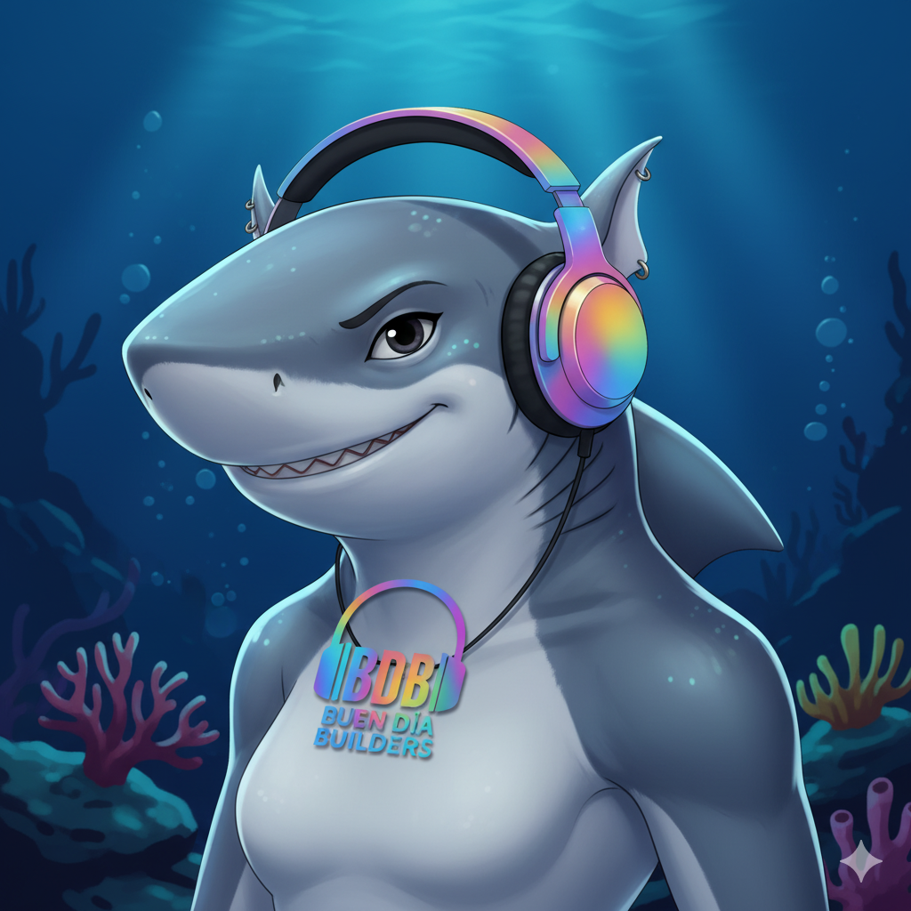

# 🦈 Código Futura — Tiburona Builder 2025

Programa intensivo de construcción en blockchain ejecutado por BuenDiaBuilders durante 2025.

Código Futura fue una experiencia de 7 semanas enfocada en desarrollo real sobre Stellar y Smart Contracts, con trabajo público en GitHub y proyectos entregables.

No fue solo teoría.  
Fue construir.

---

## 📊 Resultados

- 120+ participantes registradas  
- 12 proyectos desarrollados  
- +20 submissions en hackathons  
- Repositorios públicos con contribuciones reales  

---

## 🛠 Stack trabajado

- Stellar & Soroban  
- Rust  
- Smart Contracts  
- React  
- Integración frontend + contratos  

---

## 🌊 Espíritu Tiburona

Las Tiburonas Builders fueron:

- Persistentes  
- Técnicas  
- Colaborativas  
- Valientes para publicar código en público  

La identidad tiburona no fue un slogan.  
Fue una forma de construir.

---

## 🤝 Ecosistema

Iniciativa apoyada por:

- Stellar Development Foundation (SDF)  
- Blockchain Acceleration Foundation (BAF)  

---

## ℹ️ Estado

Edición 2025 — Programa finalizado.

El material permanece público como referencia educativa y archivo open source.

BuenDiaBuilders hoy evoluciona hacia un modelo enfocado en construcción de producto, manteniendo el espíritu tiburona: construir sin miedo.

---

**#TiburonaBuilders** • **#StellarDevelopment** • **#Web3enEspañol**

---

**🦈⚡ Vamos a construir⚡🦈**

---

**Última actualización**: Febrero 2026 | **Versión**: 1.0
**Mantenido con 💙 por**: [Buen Día Builders](https://buendiabuilders.com)

